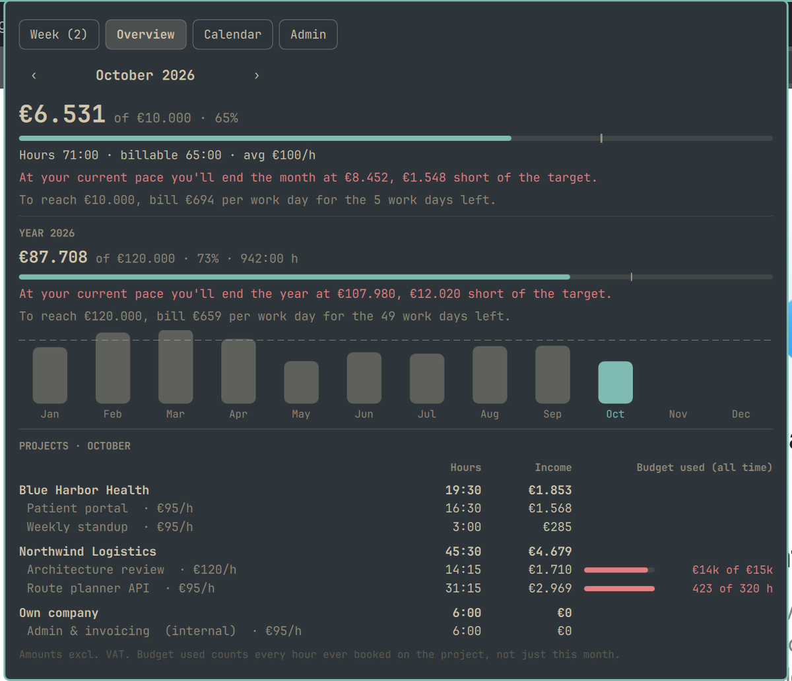

# On the Clock

Track billable hours and income from the Omarchy bar. Built for freelancers
with a few customers, a handful of projects and a couple of hourly rates.

## Install

    omarchy plugin add https://github.com/s-curve-bv/omarchy-on-the-clock.git --enable

The widget shows the running timer, or this month's income against your
monthly target. Left-click opens the panel, right-click stops the timer or
restarts the last project.

## What's in the panel

- **Week**: projects × days. Click a cell for +0:15, right-click for −0:15,
  shift-click for ±1:00, or scroll over it. ▶ starts a timer per project,
  which rounds to the nearest 0:15 when stopped.
- **Overview**: month and year income against target, with a marker for
  where you should be today and a forecast at your current pace. Below it a
  monthly chart and hours, income and budget use per customer and project.
- **Calendar**: link recurring meetings to a project. Once an occurrence has
  ended it shows up in Week, where you book it or mark that it didn't happen.
  Declined and cancelled meetings are skipped.
- **Admin**: income targets, hourly rates, customers and projects (rate,
  billable or internal, optional budget in hours or money), settings and
  backup.

While a timer runs, no keyboard or mouse input for 10 minutes (configurable)
triggers a notification and a prompt to keep or discard that idle time.

Income is hours × the project's current rate, so changing a rate also changes
past months.

## Calendar

The Calendar tab reads the events cache of the
[Datebook](https://github.com/jonspinks/omarchy-calendar) plugin
(`~/.cache/blacksheep.calendar/events.json`); it never talks to Google or
Microsoft itself. Without Datebook the rest of the plugin works as normal.
The cache path can be changed in Admin.

## Data

Everything lives in one JSON file, `~/.local/share/on-the-clock/hours.json`.
The plugin picks up changes made to it outside the panel, and won't overwrite
it if it stops being valid JSON.

### Backup

Turn on **Git history** under Admin → Backup and the data folder becomes a git
repository: a few minutes after you change something, the plugin commits
`hours.json`. Add a remote (a **private** repository, since this is your
income) and every commit is pushed as well. Pushing uses your normal git
credentials, so an SSH key or `gh auth setup-git` needs to be in place.
An existing `origin` in the folder is used when the remote field is empty.

## Commands

For keybindings or scripts:

    omarchy-shell ontheclock toggle          # stop, or restart the last project
    omarchy-shell ontheclock start <name>    # matches part of "Customer · Project"
    omarchy-shell ontheclock stop
    omarchy-shell ontheclock status
    omarchy-shell ontheclock backup          # commit and push now
    omarchy-shell shell toggle s-curve.on-the-clock '{}'   # open/close the panel

## Development

The calculations live in `Model.js`, which has no QML dependencies:

    node --test tests/test_model.js

## License

MIT
