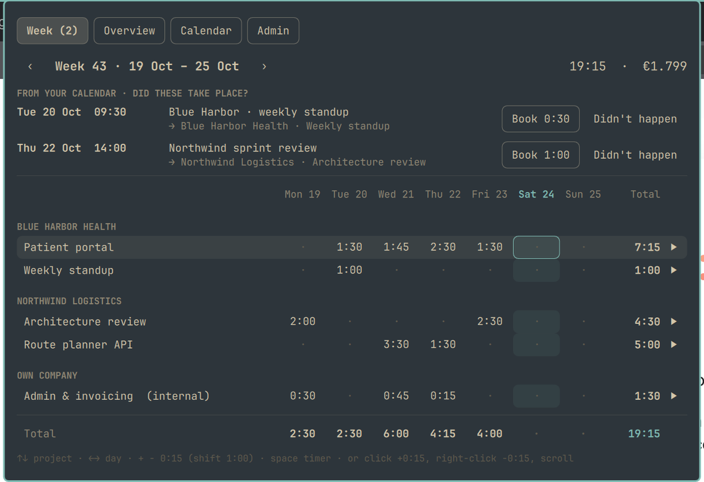
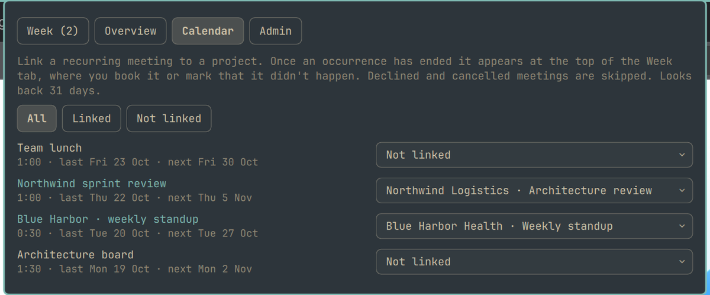
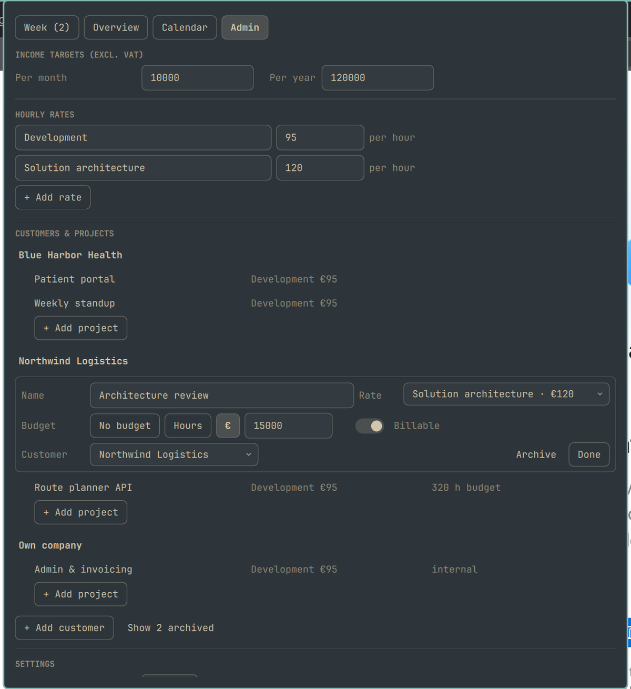

# On the Clock

Track billable hours and income from the Omarchy bar. Built for freelancers
with a few customers, a handful of projects and a couple of hourly rates.

## Install

    omarchy plugin add https://github.com/s-curve-bv/omarchy-on-the-clock.git --enable

The bar shows the project you worked on last with a ▶ button; click it to
start the timer, and ■ to stop it and book the time. While it runs, the bar
shows the elapsed time. Click the project name to open the panel.

To open the panel from the keyboard, add a binding to
`~/.config/hypr/bindings.lua`, for example:

    o.bind("SUPER + ALT + T", "On the Clock", "omarchy-shell shell toggle s-curve.on-the-clock '{}'")

## What's in the panel

A running timer sits in a strip above the tabs, with what stopping now would
book and on which day.

- **Week**: projects × days. Ended calendar meetings you linked to a project
  wait at the top to be booked or skipped. ▶ on a row starts that project's
  timer; the timer books on the day it started, rounded to the nearest 0:15,
  so it is only offered in the current week.
- **Overview**: month and year income against target, with a marker for
  where you should be today and plain-language forecasts: where your pace
  ends up and what it takes per work day to reach the target. Below it a
  monthly chart and hours, income and budget use per customer and project.
- **Calendar**: link recurring meetings to a project, filtered by all, linked
  or not linked. Declined and cancelled meetings are skipped.
- **Admin**: income targets, hourly rates, customers with their projects
  (rate, billable or internal, optional budget in hours or money), settings
  and backup. Finished projects and former customers can be archived: they
  disappear from the lists but keep counting in the months they were used.

| Week | Calendar | Admin |
|---|---|---|
|  |  |  |

### Keyboard

In the Week tab:

| Key | Does |
|---|---|
| ↑ ↓ or k j | select a project |
| ← → or h l | select a day, continuing into the previous or next week |
| + − | add or remove 0:15 in the selected cell, with shift 1:00 |
| space | start or stop the selected project's timer |
| Esc | close the panel |

With the mouse: click a cell for +0:15, right-click for −0:15, shift-click
for ±1:00, or scroll over it.

### Idle check

While a timer runs, no keyboard or mouse input for 10 minutes (configurable)
triggers a notification and a prompt to keep or discard that idle time.

Income is hours × the project's current rate, so changing a rate also changes
past months.

## Calendar

The Calendar tab reads the events cache of the
[Datebook](https://github.com/jonspinks/omarchy-calendar) plugin
(`~/.cache/blacksheep.calendar/events.json`); it never talks to Google or
Microsoft itself. Without Datebook the rest of the plugin works as normal.
The cache path can be changed in Admin.

## Data

Everything lives in one JSON file, `~/.local/share/on-the-clock/hours.json`.
The plugin picks up changes made to it outside the panel, and won't overwrite
it if it stops being valid JSON.

### Backup

Turn on **Git history** under Admin → Backup and the data folder becomes a git
repository: a few minutes after you change something, the plugin commits
`hours.json`. Add a remote (a **private** repository, since this is your
income) and every commit is pushed as well. Pushing uses your normal git
credentials, so an SSH key or `gh auth setup-git` needs to be in place.
If the folder already has an `origin`, the plugin uses it and fills in the
remote field after the first push.

### Demo mode

Click the "Data:" line at the bottom of Admin → Settings five times (or run
`omarchy-shell ontheclock demo on`) to try everything on fictional customers
and a year of hours, including archived ones. A banner shows while it is on.
Demo data lives in `~/.cache/on-the-clock-demo`, is never saved over your own
file and is never backed up; a shell restart always starts on your own data.

## Commands

For keybindings or scripts:

    omarchy-shell ontheclock toggle          # stop, or start the last project
    omarchy-shell ontheclock start <name>    # matches part of "Customer · Project"
    omarchy-shell ontheclock stop
    omarchy-shell ontheclock status
    omarchy-shell ontheclock backup          # commit and push now
    omarchy-shell ontheclock demo [on|off]   # switch to demo data and back
    omarchy-shell shell toggle s-curve.on-the-clock '{}'   # open/close the panel

The bar can show this month's income or hours instead of the project; set
`barShows` to `income`, `hours` or `icon` in the widget's settings.

## Development

The calculations live in `Model.js` and the demo data in `Demo.js`; neither
depends on QML:

    node --test tests/test_model.js
    bash tests/test_backup.sh

CI runs these tests, Omarchy's own manifest validator and shellcheck on every
push and pull request.

To retake the screenshots after a UI change:

    demo/screenshots.sh [output-folder]

It switches the plugin to demo mode, restarts the shell a few times to open
each tab, and crops the panel out of each capture. Your own data is never
touched. Without a folder it writes `screenshots/` and `preview.png`.

## License

MIT
